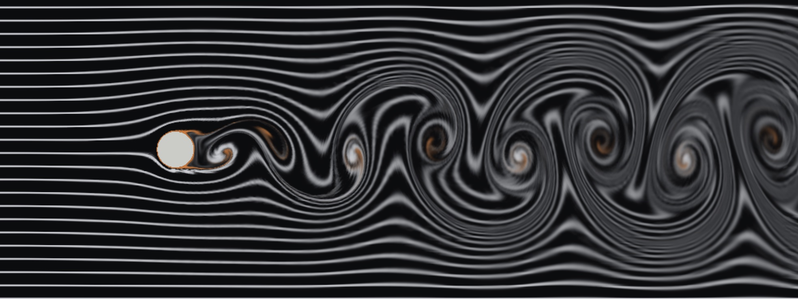
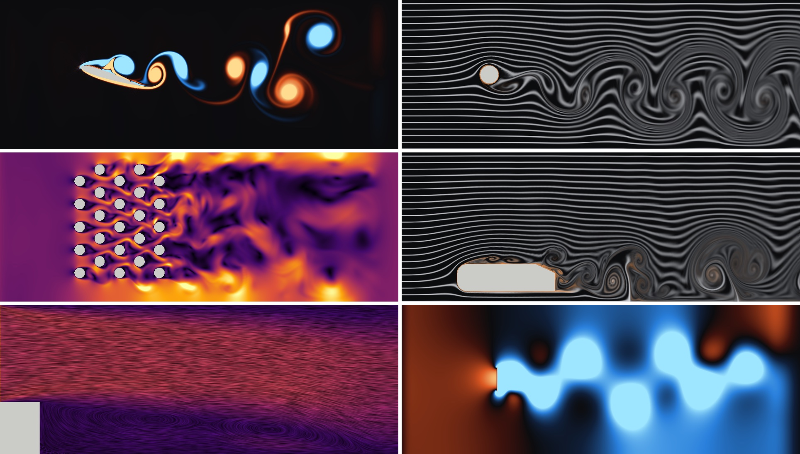

# Aeolus

A wind tunnel in the browser. Aeolus solves 2D incompressible flow around bodies in real time with the lattice Boltzmann method, running entirely in WebGPU compute shaders, and measures the forces on them: drag, lift, shedding frequency, and full parameter sweeps.

**[Open the tunnel](https://ylfeid.github.io/aeolus/)** (needs WebGPU)



Scenes: cylinder, NACA 4-digit airfoil, stalled wing, spinning cylinder (Magnus effect), flat plate, tandem cylinders, tube bank, Ahmed body, backward-facing step, empty sandbox.



## What it measures

| Readout | How |
| --- | --- |
| C<sub>D</sub>, C<sub>L</sub> | Momentum exchange on every solid cell, every frame, averaged over the last 8 convective times |
| C<sub>L</sub>′ rms | Fluctuating lift, i.e. how hard the wake is shedding |
| St | Shedding frequency from mean crossings of the lift signal, St = fL/U |
| x<sub>r</sub>/h | Reattachment length behind the step, from the sign of the near-wall velocity |
| Theory | Thin airfoil theory, potential-flow Magnus lift, or the Williamson & Brown St(Re) fit, for the current setting |

**Sweeps** step a parameter through a range and plot the averaged coefficients against it, with the theory curve dashed:

- Airfoil and stalled wing: C<sub>L</sub> and C<sub>D</sub> against angle of attack, with thin airfoil theory 2π(α − α₀) and α₀ computed from the camber line
- Cylinder: Strouhal number and C<sub>D</sub> against Reynolds number
- Magnus effect: C<sub>L</sub> against spin ratio ΩR/U, against Kutta–Joukowski 2π·ΩR/U
- Flat plate: against angle to the flow
- Ahmed body: against rear slant angle

Force histories and sweep results export as CSV.

Some numbers it reproduces at the default 1024 × 384 grid:

| Case | Aeolus | Reference |
| --- | --- | --- |
| Cylinder, Re 160: St | 0.199 | 0.186 (Williamson & Brown fit, unconfined; walls here add ~12% blockage) |
| Cylinder, Re 160: C<sub>D</sub> | 1.50 | ≈ 1.3 unconfined, higher with blockage |
| Spinning cylinder, Re 100, ΩR/U = 1: C<sub>L</sub> | 2.7 | ≈ 2.5 (published 2D laminar simulations) |
| Spinning cylinder, Re 100, ΩR/U = 2 | shedding stops, C<sub>L</sub> 6.4 | shedding suppressed above ΩR/U ≈ 1.9 |

## Controls

| Input | Action |
| --- | --- |
| Drag (Move) | Move the body |
| Drag (Draw / Erase) | Paint or erase walls; right-drag always erases |
| Space | Pause / play |
| R | Reset the flow |
| 1 – 5 | Smoke, vorticity, speed, pressure, streamlines |
| M / D / E | Move, draw, erase |
| T | Tracer particles |
| ↑ / ↓ | Step the angle of attack, spin ratio or slant (Shift: ×4) |
| C | Clear drawing |
| S | Save a screenshot |

The URL keeps the scene and its settings (`?scene=airfoil&naca=4412&alpha=8&re=2000`), so a setup can be shared as a link. `?res=512|768|1024|1536|2048` sets the grid width; the height is 3/8 of it.

## Method

Every cell carries nine populations f<sub>i</sub>, one for each velocity c<sub>i</sub> of the D2Q9 lattice. A time step streams each population to its neighbour and relaxes it towards the local equilibrium (BGK):

$$
f_i(\mathbf{x} + \mathbf{c}_i, t + 1) = f_i(\mathbf{x}, t) - \frac{1}{\tau}\left[f_i(\mathbf{x}, t) - f_i^{\mathrm{eq}}(\rho, \mathbf{u})\right]
$$

$$
f_i^{\mathrm{eq}} = w_i \rho \left(1 + 3\,\mathbf{c}_i\cdot\mathbf{u} + \tfrac{9}{2}(\mathbf{c}_i\cdot\mathbf{u})^2 - \tfrac{3}{2}|\mathbf{u}|^2\right)
$$

Density and velocity are moments, ρ = Σf<sub>i</sub> and ρ**u** = Σ**c**<sub>i</sub>f<sub>i</sub>. At low Mach number this recovers the Navier–Stokes equations with kinematic viscosity ν = (τ − ½)/3, so for a body of length L in a stream U the relaxation time follows from the Reynolds number: τ = 3UL/Re + ½.

**Turbulence model.** As Re grows τ approaches ½ and BGK becomes unstable. A Smagorinsky large-eddy model adds an eddy viscosity ν<sub>t</sub> = (C<sub>s</sub>Δ)²|S|. The strain rate comes from the non-equilibrium stress Π<sup>neq</sup> = Σ**c**<sub>i</sub>**c**<sub>i</sub>(f<sub>i</sub> − f<sub>i</sub><sup>eq</sup>), which is local to the cell, so the effective relaxation time has a closed form:

$$
\tau = \tfrac{1}{2}\left(\tau_0 + \sqrt{\tau_0^2 + 18\sqrt{2}\,C_s^2\,|\Pi^{\mathrm{neq}}| / \rho}\right), \qquad C_s = 0.16
$$

**Boundaries.**

- Bodies use halfway bounce-back. A population that would stream out of a solid is replaced by the cell's own outgoing population in the opposite direction. For the spinning cylinder that population gains 6w<sub>i</sub>ρ(**c**<sub>i</sub>·**u**<sub>wall</sub>).
- The inlet holds the free-stream equilibrium.
- The outlet is zero-gradient, behind a sponge whose extra viscosity damps vortices before they reach it.
- Thin absorbing layers at both ends relax towards the free stream, so the pressure waves from the impulsive start leave instead of ringing.
- Tunnel walls are free-slip (specular reflection) for the open test section, or no-slip for channels.

**Forces.** Every population about to bounce off a solid transfers momentum **c**<sub>i</sub>(f<sub>i</sub> + f<sub>ī</sub>) to it. One reduction kernel sums this over the whole grid each frame, and only the per-workgroup partial sums are read back.

**Visualisation.**

- Smoke is a passive scalar advected through the velocity field with a MacCormack scheme. The scheme is clamped to stay monotone, and smoke is injected at an inlet rake and at every body surface.
- Tracers are advected with RK2.
- Streamlines are line integral convolution: noise smeared along the local velocity in the fragment shader.

All quantities are in lattice units. Coefficients are per unit span and t* = tU/L counts convective times. The tunnel is two-dimensional and its walls confine the flow, so expect the right trends and magnitudes rather than free-air 3D values.

### Code map

| Path | Contents |
| --- | --- |
| `src/shaders/lbm.wgsl` | Streaming, boundaries, collision, LES, sponge |
| `src/shaders/fields.wgsl` | Macroscopic fields and the momentum-exchange force reduction |
| `src/shaders/transport.wgsl` | Smoke (MacCormack) and tracer advection |
| `src/shaders/render.wgsl` | Field colouring, LIC, tracer dots |
| `src/physics/lattice.ts` | D2Q9 constants and a CPU reference solver that mirrors the shader |
| `src/physics/geometry.ts` | NACA 4-digit outlines, thin airfoil theory, mask rasterization |
| `src/physics/analysis.ts`, `sweep.ts` | Coefficients, Strouhal estimation, reattachment, sweeps |
| `src/scenes.ts` | Scene catalogue |

### Tests

`npm test` runs the physics checks against the CPU reference solver with Node's built-in test runner:

- Equilibrium moments
- A uniform stream staying uniform
- Mass conservation
- A channel developing the Poiseuille profile (within 2%)
- Drag and Magnus lift with the right signs
- Absorbing layers damping a pressure pulse
- NACA thickness and camber
- Zero-lift angles against thin airfoil theory (NACA 2412: −2.08°)
- Strouhal estimation from a noisy signal
- Reattachment detection
- The sweep state machine

## Building

Requirements:

- [Node.js](https://nodejs.org/) 22.18 or newer (includes npm)
- A browser with WebGPU to run it: a recent Chrome or Edge, Safari 26+, or a recent Firefox

Clone and install dependencies:

```bash
git clone https://github.com/ylfeid/aeolus.git
cd aeolus
npm install
```

Start the dev server, then open the URL it prints (usually http://localhost:5173):

```bash
npm run dev
```

Run the tests:

```bash
npm test
```

Make a production build. This type-checks the code and writes the site to `dist/`:

```bash
npm run build
```

Serve that build locally to check it (usually at http://localhost:4173):

```bash
npm run preview
```

`dist/` is plain static files with relative paths, so it can be uploaded to any static host, including under a subpath.

## Deploying

`.github/workflows/deploy.yml` runs the tests, builds and publishes to GitHub Pages on pushes to `main`. Enable it under Settings → Pages → Source: GitHub Actions.

## License

MIT
